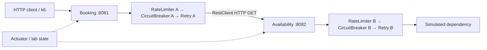
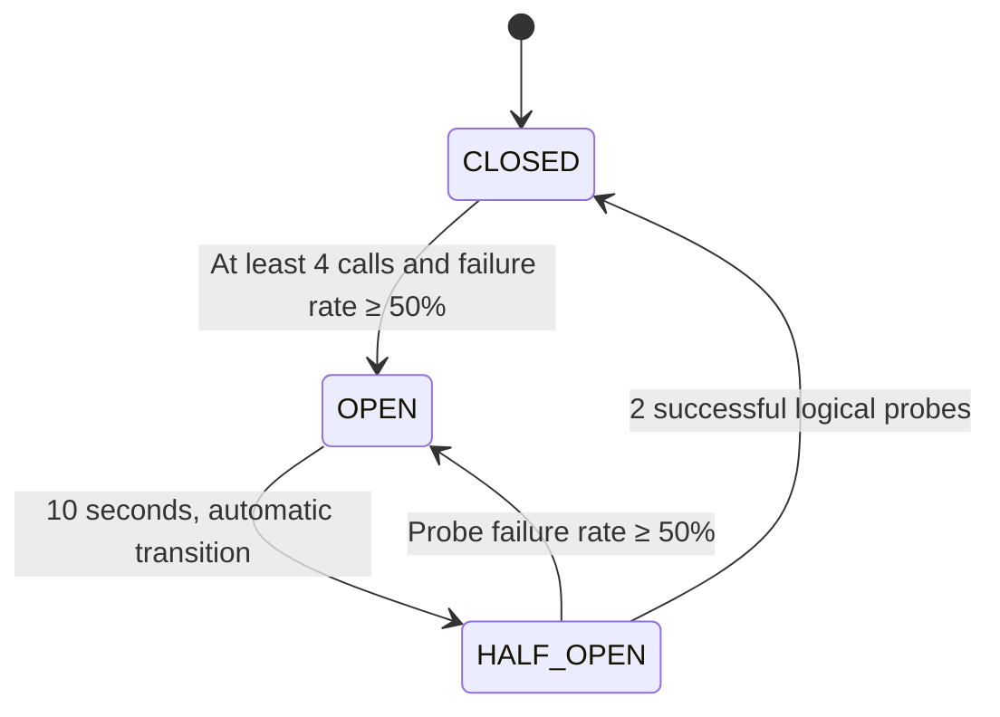

# Microservices Resilience Lab

A Java 21 / Spring Boot 4.1.2 classroom lab with two independently controlled circuit breakers, Retry, RateLimiter, Actuator, JUnit integration tests and bounded Grafana k6 tests. The existing services and business endpoints are retained. No database or third service is needed.



The complete two-breaker path is `GET booking/lab/operation` → `GET availability/lab/operation` → simulated dependency. Separate Spring-managed `LabOperation` beans prevent annotation self-invocation. Breaker A is `availabilityCircuitBreaker`; B is `dependencyCircuitBreaker`. Existing booking endpoints use A and call the original availability endpoints; those original downstream endpoints preserve their original behavior and do not use B.

## Actuator 404 diagnosis and fix

In the original booking YAML, `management` and `resilience4j` were indented inside `services.availability`. These settings did not bind, leaving only default health exposure and default breaker settings. They are now top-level namespaces. There were no duplicate YAML keys. Booking already had Actuator, `resilience4j-spring-boot4:2.4.0`, and `spring-boot-starter-aspectj`. Availability now has the same resilience and AOP dependencies.

The [published Resilience4j Boot 4 artifact](https://central.sonatype.com/artifact/io.github.resilience4j/resilience4j-spring-boot4/2.4.0) uses Spring 7 / Boot 4 dependencies. Its version is explicit because the [maintainers reported its omission from the 2.4.0 BOM](https://github.com/resilience4j/resilience4j/issues/2427). Exact compatibility here is also checked by builds, proxied-bean assertions, real transitions and HTTP Actuator tests.

Monitoring exposure is deliberately in `application-lab.yaml`. Without `lab`, only normal Actuator health exposure applies and fault-injection controllers are absent. Enable `lab` in IntelliJ's Active profiles field or with the commands below. Lab binds to `127.0.0.1`.

## Build and run (Windows PowerShell)

Run from the existing project root. Java 21 is required; Maven wrappers are included.

```powershell
.\booking-service\mvnw.cmd -f booking-service/pom.xml clean verify
.\availability-service\mvnw.cmd -f availability-service/pom.xml clean verify
```

Use two terminals, starting Availability first:

```powershell
java -jar availability-service/target/availability-service-0.0.1-SNAPSHOT.jar --spring.profiles.active=lab
```

```powershell
java -jar booking-service/target/booking-service-0.0.1-SNAPSHOT.jar --spring.profiles.active=lab
```

Stop your existing IntelliJ runs yourself before using 8081/8082. During implementation they were left running; verification used isolated ports 18081/18082. To reproduce that arrangement:

```powershell
java -jar availability-service/target/availability-service-0.0.1-SNAPSHOT.jar --spring.profiles.active=lab --server.port=18082
java -jar booking-service/target/booking-service-0.0.1-SNAPSHOT.jar --spring.profiles.active=lab --server.port=18081 --services.availability.base-url=http://127.0.0.1:18082
```

Run the latter commands in separate terminals. Stop a packaged app before rebuilding its jar on Windows, or run a copy of the jar outside `target` to avoid a file lock.

## API endpoints

| Service | Method and path | Result |
|---|---|---|
| Availability | GET `/api/availability/status` | Service status |
| Availability | GET `/api/availability/check` | `AVAILABLE` |
| Availability, lab | GET `/api/availability/simulate/failure` | Original structured HTTP 503 |
| Availability, lab | GET `/api/availability/simulate/delay` | Original 5-second delay |
| Booking | GET `/api/bookings/availability` | Calls original downstream check through A |
| Booking, lab | GET `/api/bookings/availability/failure` | Calls original downstream failure through A |
| Booking, lab | GET `/api/bookings/availability/delay` | Calls original downstream delay through A |
| Both, lab | GET `/lab/operation` | Combined RateLimiter / CircuitBreaker / Retry operation |
| Both, lab | POST `/lab/config` | Set independent fault plan; preserve breaker state |
| Both, lab | POST `/lab/reset` with `{}` | Reset breaker, plan, counters and event history |
| Both, lab | GET `/lab/state` | Actual registry state, counters, plan and last 100 events |
| Both | GET `/actuator/health` | Health |
| Both, lab | GET `/actuator/circuitbreakers` | Actual breaker registry states |
| Both, lab | GET `/actuator/circuitbreakerevents` | Buffered circuit breaker events |
| Both, lab | GET `/actuator/retries`, `/actuator/retryevents` | Retry registry/events |
| Both, lab | GET `/actuator/ratelimiters`, `/actuator/ratelimiterevents` | Limiter registry/events |
| Both, lab | GET `/actuator/metrics` | Discover metric names |

Inspect `/actuator/metrics/resilience4j.circuitbreaker.calls`, `/actuator/metrics/resilience4j.circuitbreaker.state`, `/actuator/metrics/resilience4j.retry.calls` and `/actuator/metrics/resilience4j.ratelimiter.available.permissions`. Use `?tag=name:availabilityCircuitBreaker` on Booking or `?tag=name:dependencyCircuitBreaker` on Availability. Some meters appear after the first invocation.

Rejections return structured JSON: `CIRCUIT_OPEN` → 503, `RATE_LIMITED` → 429, propagated downstream 429 → `DOWNSTREAM_RATE_LIMITED`, read/connect failure → 504. Other downstream HTTP errors retain their status. There is no success fallback hiding failures. Local 429 includes a conservative `Retry-After` based on the configured refresh period; downstream `Retry-After` is propagated when present.

Fault plan bodies:

```json
{"mode":"success","failures":0,"delayMs":0}
{"mode":"failure","failures":0,"delayMs":0}
{"mode":"transient","failures":2,"delayMs":0}
{"mode":"delay","failures":0,"delayMs":500}
```

These are four separate example bodies. `transient` fails a shared atomic number of attempts, then succeeds. Delays are bounded to 10 seconds; failure counts to 100. Configure/reset while traffic is stopped for deterministic demonstrations. `attempts` counts protected operation entries since the last configuration/reset, including retry attempts. An upstream injected failure occurs before HTTP; inspect B's counter to see whether the downstream operation ran. OPEN and local rate rejections never enter the operation. `retryAttempts` counts additional retry events; `stateTransitions` counts actual transition events since reset. Event history is bounded; cumulative counters avoid losing totals when history rolls over. Reset does not replenish limiter permits; allow a refresh period between scenarios.

## Circuit breaker transitions



CLOSED permits calls and records final outcomes in a four-call count window. OPEN immediately rejects operation execution. After ten seconds HALF_OPEN permits at most two concurrent logical probes. With the default threshold, one failure among those two probes reopens the breaker. A logical probe may contain up to three actual attempts because Retry is inside the breaker. Both all-success and all-failure recovery paths are tested; no demonstration forces OPEN or HALF_OPEN through a control endpoint.

All seven requested pairs are independently reproducible. Let `Open(X)` mean configure X to `failure`, call its own `/lab/operation` four times, then observe `OPEN`. Let `Wait(X)` mean wait until X's `/lab/state` reports `HALF_OPEN`, without sending traffic. Start each row with both services reset and a rate refresh pause.

| A | B | Sequence |
|---|---|---|
| CLOSED | CLOSED | Call A successfully |
| CLOSED | OPEN | Open(B); do not call A afterward |
| OPEN | CLOSED | Open(A), using its local injected failure |
| OPEN | OPEN | Open(A), then Open(B) |
| HALF_OPEN | CLOSED | Open(A), configure A success, Wait(A) |
| CLOSED | HALF_OPEN | Open(B), configure B success, Wait(B) |
| HALF_OPEN | HALF_OPEN | Open(A), Open(B), configure both success, Wait(A,B) |

Two successful calls to A recover both breakers from the final row. Keeping a breaker configured to failure and issuing its two probes reopens it. Pairs are snapshots: sustained traffic to A while B is OPEN eventually opens A too, because downstream 503 responses are recorded as failures. No fallback masks that propagation.

`scripts/verify-lab.py` automates the full table, both recovery paths on each service, retry counts, concurrent HTTP calls and rate-limit bursts, and saves evidence:

```powershell
python scripts/verify-lab.py
# When using the isolated ports:
python scripts/verify-lab.py --upstream http://127.0.0.1:18081 --downstream http://127.0.0.1:18082
```

## Retry and limiter configuration

Both services use the following environment variables independently. Set variables in the terminal that starts that service, then restart it.

| Variable | Default | Meaning |
|---|---|---|
| `RETRY_ATTEMPTS` | `3` | Total attempts, including the first |
| `RETRY_DELAY` | `100ms` | Fixed delay or initial backoff interval |
| `RETRY_EXPONENTIAL` | `false` | Enable exponential backoff; multiplier 2 |
| `RATE_LIMIT` | `20` | Permits per refresh period |
| `RATE_PERIOD` | `1s` | Permit refresh period |
| `RATE_TIMEOUT` | `0ms` | Immediate rejection; positive values allow waiting |
| `CB_WAIT` | `10s` | OPEN wait time |
| `READ_TIMEOUT` | `8s` | Booking HTTP read timeout |
| `CONNECT_TIMEOUT` | `1s` | Booking connection timeout |
| `AVAILABILITY_SERVICE_URL` | `http://localhost:8082` | Booking downstream base URL |

All other breaker properties can be overridden with standard Spring properties. Retryable exception classes/statuses are explicitly listed in `application.yaml`: Booking retries only HTTP **502, 503, 504** and transport failures; Availability retries only `AvailabilityDependencyException`. Change `retryExceptions` there or override its indexed Spring properties to change the policy. For example the retryable HTTP 500 subtype is `org.springframework.web.client.HttpServerErrorException$InternalServerError` (quote `$` literally in PowerShell). HTTP 429, other 4xx, local limiter rejection and local circuit-open exceptions are not retried. Only GET operations are protected; do not apply this policy to unsafe writes.

```powershell
$env:RATE_LIMIT='5'       # Repeat with 10 and 20
$env:RATE_PERIOD='1s'     # Also compare 2s
$env:RATE_TIMEOUT='0ms'  # Immediate rejection; compare 250ms or 1500ms
$env:RETRY_EXPONENTIAL='true'
$env:RETRY_DELAY='100ms' # Backoff delays: 100ms then 200ms for three attempts
# Start one service in this terminal. Use a separate terminal for the other service.
```

For upstream-only limiting, run A with 5/s and B with 100/s; reverse for downstream-only limiting. Quotas apply to logical calls because RateLimiter is outermost. Every upstream retry makes another HTTP call and therefore consumes another downstream permit. With retries at both layers, as many as 3 × 3 dependency attempts can occur for one upstream request; B's breaker may open sooner and reduce that number. This amplification is deliberate and observable. In a production design, usually choose one retry-owning layer.

## Pattern ordering experiment

Explicit aspect orders are RateLimiter `1`, CircuitBreaker `2`, Retry `3`; lower values wrap higher ones. Default behavior:

1. A limiter rejection returns 429 before breaker/retry/operation execution.
2. A circuit-open rejection bypasses Retry and downstream execution (but has consumed an outer limiter permit).
3. A CLOSED or HALF_OPEN logical call can retry a transient failure three times; the breaker records its final result once.

`PatternOrderingTests` compares CircuitBreaker(Retry(operation)) with Retry(CircuitBreaker(operation)): three failed attempts count as one versus three breaker failures. For a manual alternative experiment, override `resilience4j.retry.retryAspectOrder=1`, `resilience4j.circuitbreaker.circuitBreakerAspectOrder=2`, and `resilience4j.ratelimiter.rateLimiterAspectOrder=3`. In that arrangement, every retry consumes a limiter permit and a breaker sample. The default is restored by removing these overrides. Do not run the default acceptance assertions under alternate ordering.

Slow calls are demonstrated with B's delay plan or the original five-second route. With `READ_TIMEOUT=3s`, Booking maps read failures to HTTP 504. With retries enabled, end-to-end time can approach three read timeouts plus retry waits; a timeout does not cancel already-running server work. The circuit breaker records thrown failures; latency alone does not open this configuration. Slow-call failure thresholds and TimeLimiter are outside this assignment's implemented behavior.

## k6 tests

Install [Grafana k6](https://grafana.com/docs/k6/latest/set-up/install-k6/) and ensure `k6` is on PATH, or pass its executable path. No JavaScript package install is required. Run against idle local **lab** instances; setup resets/configures fault plans and teardown resets them. Run files sequentially because controls are shared.

```powershell
k6 run -e DURATION=10s -e VUS=1 -e SUMMARY_FILE=test-results/normal.json k6-tests/normal.js
k6 run -e DURATION=10s -e VUS=8 k6-tests/heavy.js
k6 run -e DURATION=10s -e VUS=8 k6-tests/rate-limiting.js
k6 run k6-tests/circuit-breaker.js
k6 run k6-tests/retry.js
k6 run k6-tests/dependency-failure.js
k6 run k6-tests/recovery.js
k6 run k6-tests/upstream.js
k6 run k6-tests/downstream.js
k6 run k6-tests/simultaneous.js
k6 run -e DELAY_MS=500 k6-tests/slow.js
# Full suite, saves separate JSON summaries and logs:
.\scripts\Run-K6.ps1
.\scripts\Run-K6.ps1 -Upstream http://127.0.0.1:18081 -Downstream http://127.0.0.1:18082
```

Environment options: `UPSTREAM_URL`, `DOWNSTREAM_URL`, `VUS` (1–50), `DURATION` (1s–120s), `PACE_SECONDS`, `SUMMARY_FILE`, `DELAY_MS`, `OPEN_WAIT_SECONDS` (match a custom CB wait). Safe defaults are one VU at 250ms pacing or eight VUs at 10ms pacing for traffic tests. Recovery setup observes OPEN, waits 10.5s, asserts HALF_OPEN, then load drives CLOSED. Retry injects exactly two failures at B. Failure tests accept expected 503; heavy/rate-limiting/simultaneous tests accept 429; slow tests also accept 504. Use `EXPECT_RATE_LIMIT=true` for intentionally restrictive limiter experiments with other scripts. Other statuses fail the custom `unexpected_failures < 1%` threshold. Built-in `http_req_failed` is contextual: use custom unexpected failures for scenario correctness.

`operation_duration` reports average/p95 operation latency without control calls. `response_status{status:...}` reports HTTP distribution; counters identify 429 and circuit-open responses. Standard `http_reqs` includes setup/monitoring, so operation throughput is `response_status` rate. State/attempt/retry counter deltas come from real service counters in teardown; the printed event tail gives context. Setup activity is excluded from those deltas. A slow response may be successful and an immediate 429 may be fast; compare distributions and throughput with failure/rejection counts, not latency alone. Neither low p95 nor high request throughput alone proves useful completed work.

Repeat normal/heavy/rate-limiting tests with 5, 10 and 20 permits, and with a waiting timeout. Record summaries separately; do not change fault controls concurrently with a running test. Local results are educational measurements, not capacity claims. See [test-results/RESULTS.md](test-results/RESULTS.md) for executed checks and measured values, and [DEMO.md](DEMO.md) for the presentation sequence.

## Automated validation

JUnit tests cover real AOP interception, both transition paths, HALF_OPEN retry recovery, two-probe concurrent admission, exhausted and recovered attempts, real HTTP monitoring/API routes, 429 before operation execution, concurrent requests, 5/10/20 limiter quotas, permit waiting and timeout rejection. Booking additionally checks downstream 429 exclusion and the ordering comparison. Booking's HTTP integration test uses a real bounded local HTTP stub; the Python acceptance suite verifies communication between both full processes.

No commits, branches, remotes, pushes or merges are performed as part of implementation. Review results, reload Maven in IntelliJ, enable `lab`, and use the guide with ChatGPT to prepare your presentation and version-control work.
